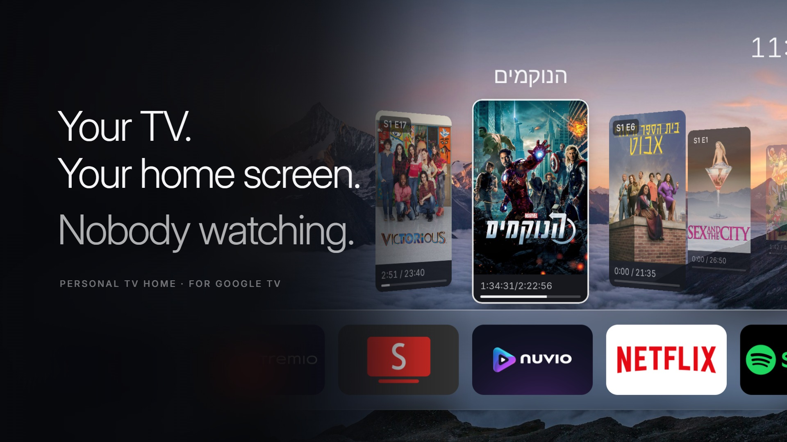

# Personal TV Home



A home screen (launcher) for Android TV and Google TV, in a "Scenic Glass" style: a photo wallpaper, a floating glass dock of your apps, a clock, weather, and a glass Settings panel. It's written in Kotlin with Jetpack Compose.

- **Glass dock:** your favourite apps, with *All Apps* at the end.
- **Continue watching:** if you use Stremio, sign in once with a QR code and your library appears as a row of 3D poster cards. SmartTube videos and Spotify tracks you played recently show up as cards too.
- **Music player:** while music plays, the album art becomes a blurred full-screen backdrop and a glass player appears above the dock.
- **Wallpapers:** built-in stock photos that rotate every 60 seconds, or your own Google Photos shared album (paste the link from your phone; the TV shows a QR code).
- **Weather:** from wttr.in, located by IP, refreshed every 30 minutes.

> **Quick start:** don't want to do this by hand? Paste [PROMPT.md](PROMPT.md) into Claude Code, Codex or any AI coding assistant that can run commands on your computer. It checks your TV, explains what ADB is, sets it up with you step by step, and adapts every step to your TV brand and Android version.

### What is ADB, and why do I need it?

ADB (Android Debug Bridge) is Google's free tool that lets a computer send commands to an Android device over your home network. Google TV has no "change home screen" menu, so ADB is the only way to install this launcher and make it your Home. You use it once during setup and then turn it off. It doesn't root the TV or change system files, and everything here can be undone (see *Undo*).

---

## Will it work on my TV?

| TV / system | Works? |
|---|---|
| Google TV or Android TV: TCL, Xiaomi / Mi TV, Hisense (Android models), Sony Bravia, Philips (Android models), Nvidia Shield, Chromecast with Google TV, Onn, most Android TV boxes | ✅ Yes |
| LG (webOS), Samsung (Tizen), Roku, Hisense VIDAA, Philips Titan OS, Panasonic (my Home Screen / Fire TV) | ❌ No. These don't run Android apps. |
| Amazon Fire TV / Fire Stick | ⚠️ It installs, but Fire OS doesn't let you change the Home screen. |

Not sure? **Settings → System → About** (or **Device Preferences → About**). If you see "Android TV OS" or an Android version, it'll work.

Requires Android 8 or newer.

---

## What you need

- A computer (Windows, Mac or Linux) on the **same Wi-Fi/network as the TV**.
- **ADB** (Android Platform Tools), free from Google: <https://developer.android.com/tools/releases/platform-tools>
  - Windows: `winget install Google.PlatformTools`
  - Mac: `brew install android-platform-tools`
  - Linux: `sudo apt install adb`
- The TV's **IP address**: Settings → Network & Internet → (your network) → IP address.

---

## Step 1: turn on developer mode and ADB on the TV

The menu names vary by brand. Use the row that matches your TV.

**1. Unlock Developer options:** find the **build** entry and press **OK** on it **7 times**, until you see "You are now a developer".

| TV | Where the build entry is |
|---|---|
| Google TV (TCL, Sony, Hisense, Chromecast, Xiaomi Google TV) | Settings → System → About → **Android TV OS build** |
| Older Android TV (Xiaomi PatchWall, Philips, Shield, boxes) | Settings → Device Preferences → About → **Build** |

**2. Turn on debugging:** go back one level and open **Developer options** (under *System* or *Device Preferences*). Then:

- Turn on **USB debugging**. On TCL TVs this toggle also enables network ADB.
- If you see **Network debugging** or **ADB debugging**, turn it on too.
- If you only see **Wireless debugging** (some newer Google TVs), turn it on. You'll need the pairing code from it in Step 2.
- Turn **off** "**Verify apps over USB**" if it's there. Otherwise the install can fail with `INSTALL_FAILED_VERIFICATION_FAILURE`.

> Some TVs cut power to their USB ports while USB debugging is on, so a USB speaker or drive can stop working. Turn debugging off again when you're done (Step 5).

---

## Step 2: connect from your computer

```sh
adb connect <TV_IP>:5555
```

The TV shows **"Allow USB debugging?"**. Tick *Always allow from this computer* and choose **Allow**. Then check:

```sh
adb devices          # should list <TV_IP>:5555   device
```

- **`unauthorized`:** the prompt is waiting on the TV. Accept it.
- **Connection refused / can't connect**, and the TV only offers *Wireless debugging*: on the TV, open Wireless debugging → **Pair device with pairing code**, then:
  ```sh
  adb pair <TV_IP>:<pairing_port>      # type the 6-digit code
  adb connect <TV_IP>:<port shown under Wireless debugging>
  ```

---

## Step 3: install the app

Download **`personal-tv-home.apk`** from the [latest release](https://github.com/alex99ka/personal-tv-home/releases/latest), then:

```sh
adb -s <TV_IP>:5555 install -r personal-tv-home.apk
# lets the launcher see what's playing, for the music player
adb -s <TV_IP>:5555 shell cmd notification allow_listener local.personalhome/local.personalhome.MusicListener
```

If you get `INSTALL_FAILED_VERIFICATION_FAILURE`, turn off **Verify apps over USB** in Developer options and try again.

---

## Step 4: make it your Home screen

```sh
adb -s <TV_IP>:5555 shell cmd package set-home-activity local.personalhome/.MainActivity
adb -s <TV_IP>:5555 shell input keyevent HOME
```

Press **Home** on the remote. Personal TV Home should appear.

**Still getting the old home screen?** Some TVs (mostly Google TV) keep sending Home to the built-in launcher. You can disable it. This is reversible:

```sh
adb -s <TV_IP>:5555 shell pm disable-user --user 0 com.google.android.apps.tv.launcherx   # Google TV
# older Android TV: com.google.android.tvlauncher   ·  Xiaomi PatchWall: com.mitv.tvhome
```

Side effects on Google TV: the "For you" tab and the Google account switcher are gone, and a few Google settings screens (for example, picking Google Photos albums for the Ambient screensaver) need the stock launcher. Re-enable it temporarily for those (see *Undo*).

---

## Step 5: lock it back down

When everything works, go to Developer options on the TV and turn **USB debugging / Network debugging / Wireless debugging off**. The launcher keeps working, and nobody else on your network can connect to the TV.

---

## Adapting it to your TV

Every brand ships a slightly different Google TV / Android TV. What changes, and what to do:

| Difference | What to do |
|---|---|
| **Menu names** (About, Developer options) | Google TV: *System → About*. Older Android TV / Xiaomi / Philips / Shield: *Device Preferences → About*. |
| **ADB toggle** | TCL: *USB debugging* also opens network ADB on port 5555. Sony / Philips / Shield: also turn on *Network debugging*. Some Android 11+ devices only have *Wireless debugging*: use `adb pair` (Step 2). |
| **Which stock launcher takes Home** | Find it: `adb shell cmd package resolve-activity -a android.intent.action.MAIN -c android.intent.category.HOME`. Google TV: `com.google.android.apps.tv.launcherx` · Android TV: `com.google.android.tvlauncher` · Xiaomi PatchWall: `com.mitv.tvhome`. Disable only the one that shows up. |
| **Apps blocked after reboot (TCL, Xiaomi)** | TCL: `adb shell appops set local.personalhome APP_AUTO_START allow`. Xiaomi: allow *Personal TV Home* under Autostart in the app permissions. |
| **Remote's Settings button** | On TCL it opens this launcher's panel. Other remotes may open the TV's own quick settings; use the round button at the top right instead. |
| **Android version** | Needs Android 8+. Check *About → Android version*, or `adb shell getprop ro.build.version.sdk` (26 or higher). |
| **Install refused** | `INSTALL_FAILED_VERIFICATION_FAILURE`: turn off *Verify apps over USB*. `INSTALL_FAILED_OLDER_SDK`: the TV is too old. |
| **TV vanishes from ADB** | Many TVs drop Wi-Fi in deep standby. Wake it with the remote and `adb connect` again. |

Something else? Ask your AI assistant (with PROMPT.md) or open an issue with your brand, model and Android version.

---

## Using it

- **Home:** the dock holds your favourite apps. *All Apps* is at the end.
- **Hold OK on an app:** Open, App info, or Add to bar / Remove from bar (the dock).
- **Settings:** the round button at the top right, or the Settings button on your remote. It has Chromecast settings (the TV's own settings), Home, Discover, My Space, Apps, Search, Wallpapers, Appearance and Stremio account.
- **Stremio row:** Settings → **Stremio account** → scan the QR code with your phone and sign in.
- **Google Photos wallpaper:** Settings → Wallpapers → Google Photos → scan the QR code and paste a *shared album* link from the Google Photos app on your phone.
- **Music:** play something in Spotify (or any music app) and press Home. Left/Right on the player seeks 15 seconds.

---

## Undo / go back

```sh
adb connect <TV_IP>:5555
# if you disabled the stock launcher, re-enable it (use the package you disabled)
adb -s <TV_IP>:5555 shell pm enable com.google.android.apps.tv.launcherx
adb -s <TV_IP>:5555 uninstall local.personalhome
```

The TV goes back to its normal home screen.

---

## Updating

Download the new APK from the latest release and run `adb -s <TV_IP>:5555 install -r personal-tv-home.apk`. Your dock, wallpaper and Stremio sign-in are kept.

---

## Build from source (optional)

You need JDK 17 and the Android SDK (`local.properties` with `sdk.dir=...`).

```sh
./install.sh <TV_IP>           # build + install
./install.sh <TV_IP> --home    # build + install + set as Home
./install.sh <TV_IP> --home path/to/personal-tv-home.apk   # install a prebuilt APK, no build
```

The release APK is signed with a debug key, because it's meant for sideloading over ADB.
